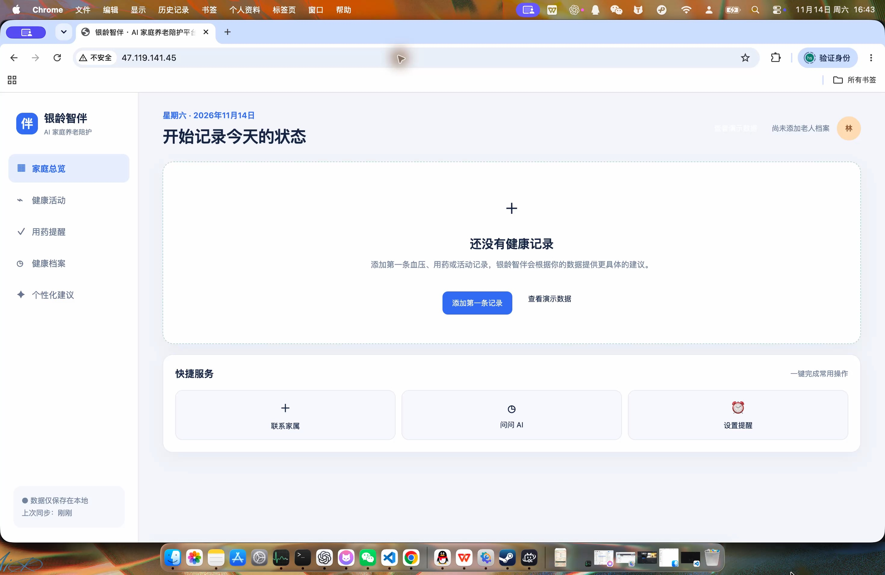
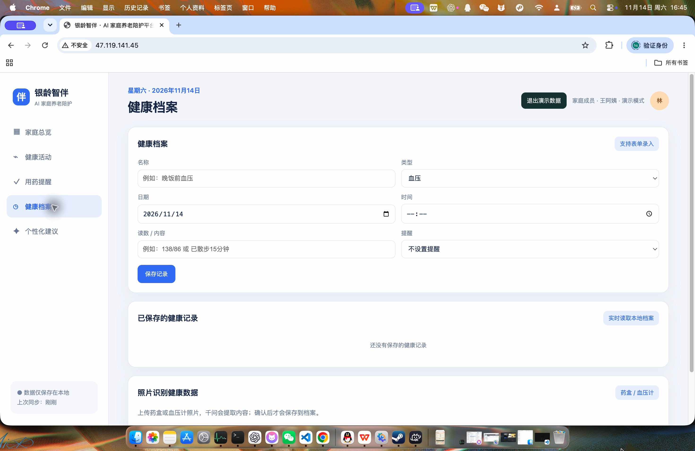
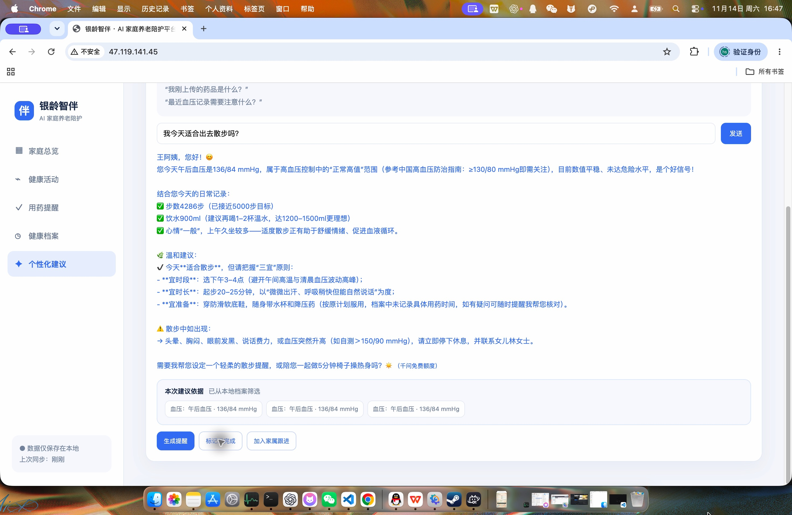

# 银龄智伴 · AI 家庭养老陪护平台作品介绍文档

> 参赛学校：广东科贸职业学院　参赛方式：个人参赛　队员：林伟健
>
> 本文按“作品介绍文档”要求编写，覆盖项目详情、使用方式、亮点、AI 技术落地、关键技术、项目图片、发表/获奖情况和项目迭代说明。

## 1. 项目详情及使用方式

### 1.1 项目定位

“银龄智伴”是一款面向独居老人和家庭照护者的 AI Web 陪护平台。它把药盒照片、血压/活动等手动记录、用药计划和照护任务汇总为可持续读取的健康档案，再由千问根据相关档案回答“我今天适合出去散步吗？”等生活问题，给出带依据、可执行、可转成提醒的建议。

项目解决的问题是：老年人的健康数据常分散在纸条、药盒、血压计和家属聊天中，普通聊天机器人又无法持续记住已经确认的数据。银龄智伴把“记录—理解—建议—行动”连成一个闭环。

### 1.2 使用流程

1. **进入首页**：查看今日状态、健康记录、用药提醒和快捷服务。
2. **录入档案**：在“健康档案”中填写名称、类型、日期、时间、读数/内容和提醒，点击“保存记录”。数据写入本地档案，刷新页面后仍保留。
3. **照片识别**：上传药盒或血压计照片，千问视觉模型先提取候选信息；用户核对并点击“确认保存”后，信息才写入档案，识别不确定的字段保持待确认。
4. **提出问题**：进入“个性化建议”，输入散步、用药或近期状态等问题。后端先按问题主题筛选相关记录，再将最小必要上下文交给千问。
5. **查看依据**：回答下方展示“本次建议依据”，列出实际使用的血压、活动、睡眠或用药记录，方便核对。
6. **转成行动**：可生成提醒、标记完成或加入家属跟进；提醒删除和完成状态会保存到档案。
7. **评委演示**：点击“查看演示数据”进入预置案例；退出演示后返回真实空档案，真实数据与演示数据分离。

### 1.3 运行方式

```bash
cd 为传智杯省赛——AI Web 网页开发
export DASHSCOPE_API_KEY="你的千问 API Key"
python3 server.py
```

打开 `http://127.0.0.1:4173/`。不配置 API Key 时可使用本地演示回答；配置 Key 后，文本问答调用 `qwen-plus`，照片识别调用 `qwen3-vl-plus`。API Key 只从后端环境变量读取，不写入前端和公开仓库。

## 2. 项目亮点

### 2.1 档案驱动的个性化问答

千问不是孤立的聊天入口。后端根据问题主题筛选相关记录，回答中明确展示证据卡片。例如询问散步时，系统会读取当天血压、步数、饮水和心情等记录，给出时间、时长、准备事项和异常信号建议。

### 2.2 从建议到行动的闭环

回答可以继续生成提醒、标记完成或加入家属跟进，用户的操作写回档案。这样 AI 输出从一次性文字变成可追踪的照护任务。

### 2.3 多模态、人工确认的录入方式

药盒和血压计照片可作为数据入口，但识别和保存分成两步。系统展示候选字段，由用户确认后才入档，降低视觉模型误读造成错误记录的风险。

### 2.4 真实档案与演示档案隔离

真实档案默认为空，评委可以一键进入预置案例查看完整功能；退出演示后恢复真实档案。该机制既方便复现，也避免把虚构演示数据混入真实记录。

### 2.5 适老化交互与安全兜底

界面使用大字号、高对比按钮和清晰的分区；千问不可用时保留本地演示路径；涉及胸痛、呼吸困难、意识异常等危险信号时，回答优先提示停止活动并联系家属或急救服务。系统不做诊断、不改药，也不把“没有记录”解释成“没有症状”。

## 3. AI 测试技术落地使用情况概述

### 3.1 文本大模型落地

- **模型**：阿里云百炼兼容 OpenAI 接口的 `qwen-plus`。
- **调用位置**：后端 `/api/chat`，前端只提交问题和演示模式标记。
- **上下文策略**：根据问题主题选择记录；散步/运动问题优先读取活动、血压、心率和睡眠，用药问题读取药品和提醒，无关字段不发送。
- **输出约束**：系统提示词要求使用档案事实、区分已记录与待确认信息、给出具体行动和危险信号提示，并避免诊断和擅自改药。
- **可解释性**：接口同时返回证据列表，前端把实际使用的记录显示在“本次建议依据”区域。

### 3.2 视觉模型落地

- **模型**：`qwen3-vl-plus`。
- **调用位置**：后端 `/api/vision`。
- **输入输出**：上传药盒或血压计照片，模型输出药品名称、规格、日期、读数等候选字段。
- **确认机制**：视觉结果只进入待确认卡片，点击“确认保存”后才调用 `/api/record` 写入健康档案。

### 3.3 典型测试记录

| 测试场景 | 输入 | 系统处理 | 可见结果 |
|---|---|---|---|
| 个性化散步建议 | “我今天适合出去散步吗？” | 筛选当天血压、步数、饮水和心情 | 返回时段、时长、准备事项和异常信号，并显示依据卡片 |
| 新增健康记录 | “午后血压 136/84 mmHg” | 表单提交 `/api/record` 写入本地 JSON | 健康档案显示记录，刷新后仍存在 |
| 药盒照片识别 | 上传药盒照片 | `/api/vision` 返回候选药品字段 | 用户确认后保存，未确认字段不自动补全 |
| 提醒操作 | 生成或删除提醒 | `/api/action`、`/api/task` 更新档案 | 提醒状态和删除结果跨刷新保留 |
| 模型不可用 | 未配置 API Key | 使用本地演示回答 | 页面仍可完成评委演示，不暴露密钥 |

## 4. 项目中涉及的关键技术

### 4.1 前端与交互

- HTML5、CSS3、JavaScript 单页 Web 前端；响应式布局适配常见桌面和移动宽度。
- 以页面状态驱动家庭总览、健康活动、用药提醒、健康档案和个性化建议等模块。
- 表单校验、空状态、加载状态、成功反馈和错误兜底均在前端完成。

### 4.2 后端与数据层

- Python 标准库 `http.server` 提供轻量 HTTP 服务和 JSON API。
- `elder_profile.json` 保存真实档案，`demo_profile.json` 保存演示档案。
- `/api/profile` 读取档案；`/api/record` 保存健康记录；`/api/action` 保存提醒/完成/家属跟进；`/api/task` 保存待办删除状态。
- 本地优先存储便于比赛现场部署和复现，后续可迁移到授权的加密数据库。

### 4.3 AI 集成与安全

- 通过阿里云百炼兼容接口调用千问文本和视觉模型。
- API Key 使用环境变量 `DASHSCOPE_API_KEY`，公开仓库只提供 `.env.example`。
- 通过主题筛选减少上下文噪声和隐私暴露；通过证据卡片和确认保存降低幻觉与误识别风险。
- 模型不可用时提供本地回答，保证演示可用性。

### 4.4 部署与验证

- 支持本地 `python3 server.py` 启动，也可部署到 Ubuntu 阿里云 ECS，由 Nginx 反向代理。
- 已验证页面启动、档案读取、健康记录保存、提醒删除、演示切换、千问问答和本地接口。
- 提交前执行 `python3 check_submission.py`，语法、数据结构、页面文案和 `/api/profile` 检查均通过。

## 5. 项目相关图片/照片

以下图片来自项目实际运行画面，用于说明主要使用路径。

### 5.1 空档案首页与快捷服务



首页以“开始记录今天的状态”为入口，提供添加记录、查看演示数据、联系家属、问问 AI 和设置提醒等操作。

### 5.2 健康档案表单



健康档案支持名称、类型、日期、时间、读数/内容和提醒字段，保存后写入本地档案。

### 5.3 结合档案的千问回答



个性化建议页面展示“我今天适合出去散步吗？”的回答、具体行动建议和本次使用的档案依据。

## 6. 项目发表、获奖情况

截至本次提交前，本项目未在其他赛事、论文、商业产品或公开平台以获奖作品形式正式发表，也未获得其他奖项。本项目为广东科贸职业学院个人参赛作品，当前提交用于本次全国高校 AI Web 开发挑战赛省赛评审。

## 7. 项目基础与本次优化说明

本项目不是直接复制第三方成品或只更换页面文字，而是在本人前期“银龄智伴”原型基础上持续迭代完成。前期原型主要用于验证页面结构和千问调用，本次参赛版本完成了以下实质优化：

1. **数据从展示变为真实保存**：健康档案、药品识别确认结果、提醒和待办删除均写入本地数据文件，刷新后可读取。
2. **AI 从单轮回答变为档案问答**：新增按问题主题筛选记录、构造最小上下文和返回证据卡片的流程。
3. **增加视觉识别确认链路**：照片识别和确认保存分离，避免模型直接修改健康档案。
4. **增加演示模式隔离**：演示档案、真实档案和退出演示操作相互隔离，便于评委复现。
5. **补齐操作闭环**：快捷服务、提醒生成、提醒删除、完成状态、家属跟进均接入后端接口。
6. **强化安全和兜底**：加入危险信号提示、未确认字段标记、无 API Key 时的本地演示回答和环境变量配置。
7. **完善参赛交付**：补充运行说明、测试脚本、技术文档、7 分钟演示视频和阿里云在线演示。

## 8. 项目局限与后续计划

当前版本以单机本地档案为主，尚未接入医院系统、可穿戴设备、短信/电话网关和多用户权限体系。后续可在取得用户授权的前提下增加家属端、语音交互、设备自动同步、异常趋势检测、加密存储和细粒度权限管理。
